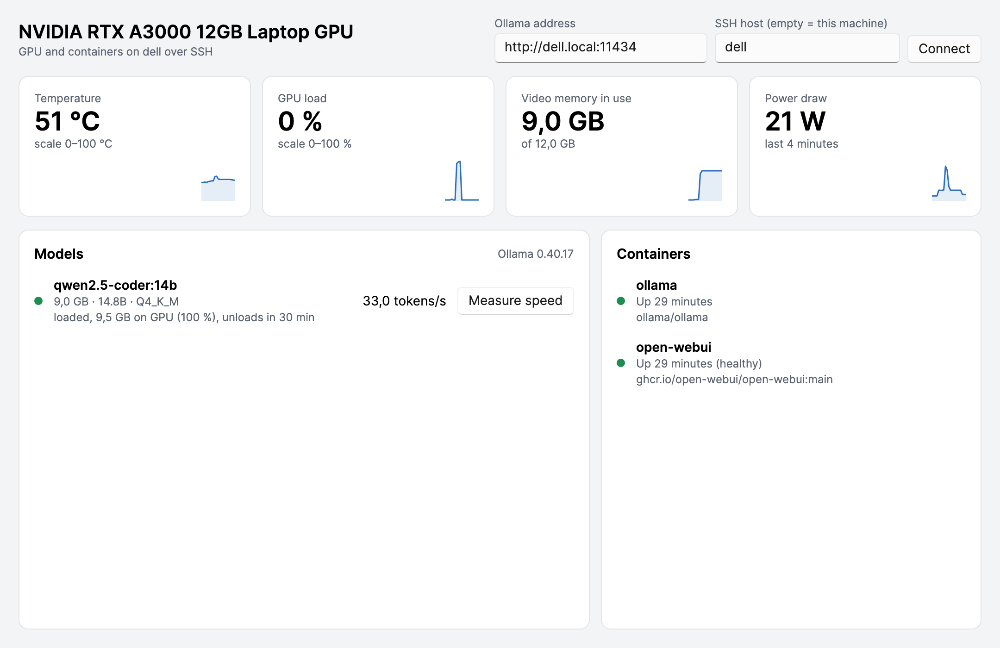

# AI Box Dashboard

A small desktop app that shows what a local AI machine is doing: GPU temperature, load, video memory and power,
the Ollama models that are installed and loaded, and the state of its Docker containers.

It runs on the machine itself, or on another computer that watches it over the network.
Built with .NET 11 and [Avalonia](https://avaloniaui.net), so the same code runs on Linux, macOS and Windows.



## What it shows

- **GPU**: temperature, load, video memory in use and power draw, each with a chart of the last four minutes.
- **Models**: every model Ollama has installed, whether it is loaded, how much of it sits on the GPU, and when it unloads.
- **Speed**: "Measure speed" generates a short text and reports tokens per second. It loads the model if it is not loaded.
- **Containers**: name, image and status of each Docker container.

## Requirements

- .NET 11 SDK to build and run.
- On the machine being watched: an NVIDIA GPU with `nvidia-smi`, [Ollama](https://ollama.com), and optionally Docker.
- To watch another machine: key-based SSH access to it (the app runs `ssh <host> nvidia-smi` and `ssh <host> docker ps`;
  it never asks for or stores a password) and its Ollama port reachable over the network.

## Run

On the AI machine itself:

```bash
dotnet run
```

From another computer:

```bash
dotnet run -- --ollama http://my-ai-box.local:11434 --ssh my-ai-box
```

The same two settings are at the top of the window. Press **Connect** to apply and save them.

## How it reads the data

| Data | Source |
|---|---|
| GPU readings | `nvidia-smi --query-gpu=...`, every 2 seconds |
| Models and loaded state | Ollama HTTP API (`/api/tags`, `/api/ps`) |
| Speed | Ollama `/api/generate` with a fixed 128-token request |
| Containers | `docker ps --all`, every 10 seconds |

Only the first GPU is shown, and only NVIDIA GPUs are supported so far.

## License

MIT. See [LICENSE](LICENSE).
